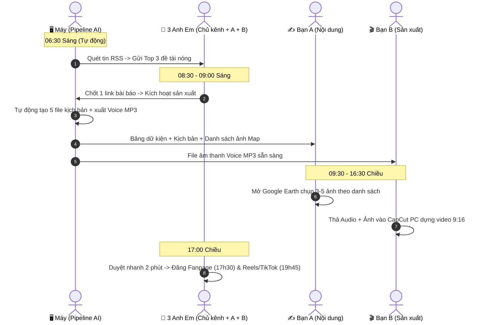

# HƯỚNG DẪN VẬN HÀNH & TỰ ĐỘNG HÓA PIPELINE
### Kênh Dữ Liệu BĐS, Bản Đồ & Quy Hoạch Đa Nền Tảng

> Tài liệu này kết hợp **Lịch trình vận hành hàng ngày cho 3 anh em** và **Hướng dẫn cài đặt tự động hóa theo khung giờ cố định** trên hệ thống máy tính Windows.

---

## PHẦN 1: LỊCH TRÌNH VẬN HÀNH & CÁC LỆNH HÀNG NGÀY

Quy trình phối hợp 3 người bám sát theo [sop_ban_giao_kenh_bds.md](sop_ban_giao_kenh_bds.md) và bộ quy tắc [CLAUDE.md](CLAUDE.md):



---

### Bảng tra cứu lệnh theo khung giờ

| Khung giờ | Ai thực hiện | Việc cần làm | Lệnh thực hiện (Chạy trên Terminal) |
| :--- | :--- | :--- | :--- |
| **06:30** | **Máy** (hoặc Bạn A) | Quét tin nóng từ 5 báo uy tín, lọc từ khóa, chấm điểm Hot | Tự động chạy qua Task Scheduler, hoặc bấm đúp chuột vào: <br>`C:\BĐS\scripts\run_morning_radar.bat`<br>*(hoặc lệnh: `python -m pipeline.run_pipeline --radar`)* |
| **09:00** | **Chủ kênh / Bạn A** | Chốt 1 bài báo -> Kích hoạt máy sinh trọn bộ kịch bản & file âm thanh | `python -m pipeline.run_pipeline --url "<link_bai_bao>"` |
| **Khi cần** | **Bạn A / Bạn B** | Sau khi sửa lại câu từ trong `04_Loi_Doc_TTS.txt`, muốn xuất lại file MP3 | `python -m pipeline.run_pipeline --tts` |
| **Khác** | **Bất kỳ ai** | Chạy lại sản xuất cho một ngày cụ thể trong quá khứ | `python -m pipeline.run_pipeline --url "<link>" --date "YYYY-MM-DD"` |

---

### Chi tiết các bước thực hiện:

#### Bước 1: Xem đề xuất tin nóng (06:30 - 09:00)
- Mở file báo cáo mới nhất tại thư mục: `01_Radar_Tin_Tuc/[YYYY-MM-DD]_Radar_Tin_Nong.md`.
- Hoặc xem tin nhắn tóm tắt Top 3 đề tài gửi về nhóm Telegram (nếu đã kết nối Bot).
- 3 anh em thảo luận và chốt **duy nhất 1 đề tài chủ lực** trong ngày.

#### Bước 2: Kích hoạt sản xuất trọn gói (09:00)
Chạy lệnh kèm link bài báo vừa chốt:
```powershell
python -m pipeline.run_pipeline --url "https://tuoitre.vn/khoi-cong-cau-cat-lai-va-cau-long-hung-noi-dong-nai-voi-tphcm-100260929111812275.htm"
```
*Chỉ sau 30-45 giây, máy sẽ hoàn tất 3 khâu:*
1. **Cào dữ liệu gốc:** Tiêu đề, tác giả, ngày giờ, nội dung văn bản.
2. **Sinh bộ 5 file chuẩn CLAUDE.md:**
   - `01_Bang_Du_Kien.md` (Fact Sheet phân loại mức tin cậy A/B/C)
   - `02_Kich_Ban_Video.md` (Kịch bản 5 cột: Giây \| Lời đọc \| Visual \| Chữ màn hình \| Dữ kiện #)
   - `03_Bai_Fanpage.md` (Bài viết phân tích chuyên sâu 600 - 800 từ)
   - `04_Loi_Doc_TTS.txt` (Lời đọc chuẩn hóa dịch 100% số/viết tắt thành chữ tiếng Việt)
   - `Danh_Sach_Anh_Can_Chup.md` (Danh sách 3-5 góc Google Earth 3D với vạch Đỏ/Vàng)
3. **Tạo audio giọng đọc AI:** Tự động xuất file âm thanh `voice_doc_ai.mp3` vào thư mục `04_Audio/[ngày]/`.

#### Bước 3: Phối hợp hoàn thiện sản phẩm (09:30 - 16:30)
- **Bạn A (Nội dung & Dữ liệu):**
  - Mở `03_Anh_Tu_Lieu/[ngày]/Danh_Sach_Anh_Can_Chup.md`.
  - Mở Google Earth Pro chụp 3-5 góc đúng theo từ khóa và vẽ vạch đỏ (hướng tuyến) / vạch vàng (ranh giới). Lưu ảnh vào thư mục `03_Anh_Tu_Lieu/[ngày]/`.
- **Bạn B (Sản xuất Video):**
  - Lấy file âm thanh `04_Audio/[ngày]/voice_doc_ai.mp3` thả vào CapCut PC.
  - Bấm tính năng Auto-caption (tự tạo phụ đề nhảy chữ).
  - Ghép 3-5 ảnh bản đồ từ Bạn A vào đúng các mốc giây trong `02_Kich_Ban_Video.md`.
  - Xuất video chuẩn dọc 9:16.

#### Bước 4: Duyệt và đăng bài đa kênh
- **17h30:** Đăng bài viết Fanpage (`03_Bai_Fanpage.md`) kèm album 3-5 ảnh bản đồ nét cao.
- **19h45:** Đăng Video ngắn lên TikTok và Facebook Reels (sử dụng caption và hashtag có sẵn ở cuối file `02_Kich_Ban_Video.md`).

---

## PHẦN 2: HƯỚNG DẪN THIẾT LẬP TỰ ĐỘNG HÓA THEO KHUNG GIỜ CỐ ĐỊNH

Để máy tính tự động quét tin nóng lúc **06:30 sáng** mỗi ngày mà không cần con người phải gõ lệnh:

### Cách 1: Thiết lập tự động qua Windows Task Scheduler (Khuyến nghị)
Hệ điều hành Windows sẽ tự động đánh thức tác vụ và chạy ngầm:

1. Nhấp chuột phải vào nút **Start ( biểu tượng Windows )**, chọn **Terminal (Admin)** hoặc **PowerShell (Admin)**.
2. Chạy đúng 1 dòng lệnh sau:
   ```powershell
   powershell -ExecutionPolicy Bypass -File C:\BĐS\scripts\setup_windows_scheduler.ps1
   ```
3. **Kết quả:** Windows thông báo `[OK] Da dang ky thanh cong Windows Task Scheduler!`.
   - Tên tác vụ: `BDS_Radar_Morning_6h30`
   - Lịch chạy: `06:30 AM` mỗi ngày.
   - Thao tác: Tự động chạy file `C:\BĐS\scripts\run_morning_radar.bat`, quét tin và lưu sẵn báo cáo vào `01_Radar_Tin_Tuc/`.

*(Tùy chọn chỉnh sửa giờ: Nhấn tổ hợp phím `Windows + R`, gõ `taskschd.msc` rồi Enter. Tìm tên `BDS_Radar_Morning_6h30` để chỉnh sang 06:00 hay 07:00 tùy ý).*

---

### Cách 2: Chạy chế độ Daemon bằng Python
Nếu máy tính cá nhân hoặc máy bàn luôn mở, bạn có thể để một cửa sổ dòng lệnh chạy thường trực:
```powershell
python -m pipeline.run_pipeline --scheduler --time "06:30"
```
- Tiến trình sẽ chạy ở trạng thái chờ và không tốn CPU/RAM.
- Cứ đúng **06:30 sáng**, tiến trình sẽ tự động đánh thức và quét tin nóng.

---

### Cách 3: Bắn thông báo tự động về điện thoại qua Telegram (Tùy chọn)
Để 3 anh em có thể nhận ngay đề xuất tin nóng trên điện thoại lúc 6h30 sáng khi vừa thức dậy:
1. Mở ứng dụng Telegram, tìm bot `@BotFather`, gửi `/newbot` để tạo bot và copy chuỗi **API Token**.
2. Tạo 1 nhóm chat gồm 3 anh em trên Telegram, thêm Bot vừa tạo vào nhóm.
3. Lấy `Chat ID` của nhóm (thêm bot `@myidbot` vào nhóm rồi gõ `/getgroupid`).
4. Mở file [pipeline/config.py](pipeline/config.py) và cập nhật 2 dòng:
   ```python
   TELEGRAM_BOT_TOKEN = "chép_token_của_bot_vào_đây"
   TELEGRAM_CHAT_ID = "chép_group_chat_id_vào_đây"
   ```
Từ đây, mỗi sáng lúc 6h30, máy tính chạy xong Radar sẽ tự động "ting ting" Top 3 đề tài kèm tóm tắt và link gốc trực tiếp vào điện thoại của cả 3 người.

---

## PHẦN 3: CẤU TRÚC LƯU TRỮ THƯ MỤC THÀNH PHẨM

Toàn bộ dữ liệu được tổ chức tự động theo ngày (`YYYY-MM-DD`) để không bao giờ bị lẫn lộn:

```
C:\BĐS\
├── 01_Radar_Tin_Tuc\
│   └── 2026-10-01_Radar_Tin_Nong.md     <- Báo cáo tin nóng quét được
│
├── 02_Kich_Ban_Bai_Viet\
│   └── 2026-10-01\
│       ├── 01_Bang_Du_Kien.md           <- Bảng dữ kiện fact-check A/B/C
│       ├── 02_Kich_Ban_Video.md         <- Kịch bản phân cảnh video 9:16
│       ├── 03_Bai_Fanpage.md            <- Bài viết Facebook 600-800 từ
│       ├── 04_Loi_Doc_TTS.md            <- Lời đọc định dạng Markdown
│       └── 04_Loi_Doc_TTS.txt           <- Lời đọc thuần túy (số thành chữ)
│
├── 03_Anh_Tu_Lieu\
│   └── 2026-10-01\
│       ├── Danh_Sach_Anh_Can_Chup.md    <- Hướng dẫn góc chụp Google Earth
│       └── (Các ảnh bản đồ do Bạn A chụp lưu tại đây)
│
└── 04_Audio\
    └── 2026-10-01\
        └── voice_doc_ai.mp3             <- File âm thanh đọc kịch bản hoàn chỉnh
```
