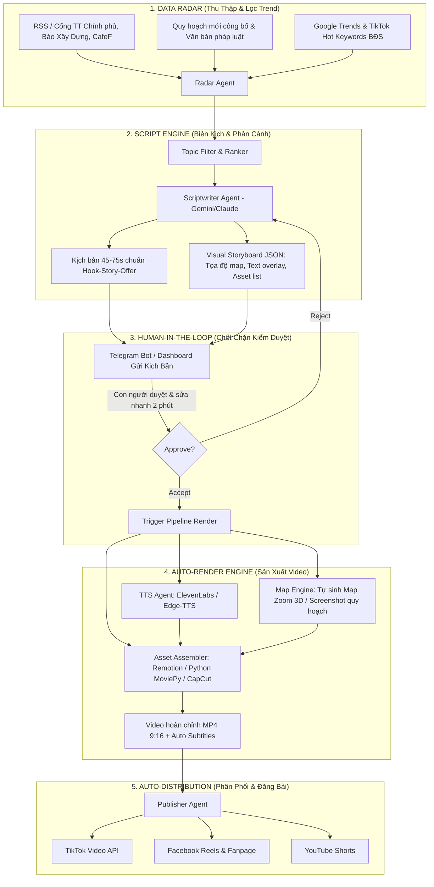

# BLUEPRINT: HỆ THỐNG KÊNH NỘI DUNG BĐS & QUY HOẠCH VẬN HÀNH BẰNG AI AGENT (HUMAN-IN-THE-LOOP)

> Ngày lập: 23/09/2026  
> Nền tảng mục tiêu: TikTok, Facebook Reels, Facebook Page Post  
> Mô hình vận hành: AI Agent tự động hóa 80% + Human Review 20%

---

## I. BÁO CÁO TÍNH KHẢ THI (FEASIBILITY REPORT)

### 1. Đánh giá tính khả thi theo từng khâu

| Khâu quy trình | Mức độ khả thi AI | Công cụ đề xuất | Điểm nghẽn (Bottleneck) & Giải pháp |
| :--- | :---: | :--- | :--- |
| **1. Radar săn tin & bắt trend** | **95%** (Rất cao) | Python Scraper, RSS Reader, Google Trends, LLM (Gemini/Claude) | **Nghẽn:** Tin rác, tin giật gân sai lệch. **Giải pháp:** Lọc danh sách whitelist (Báo Xây Dựng, Thư viện pháp luật, Vietstock, CafeF, Cổng TT Điện tử Chính phủ). |
| **2. Lên ý tưởng & Viết kịch bản** | **90%** (Rất cao) | LLM Prompting chuyên sâu (Gemini 1.5 Pro / GPT-4o / Claude 3.5 Sonnet) | **Nghẽn:** Ảo giác số liệu (Hallucination) về số tờ, số thửa, giá tiền. **Giải pháp:** Quy tắc RAG nạp trích dẫn gốc bắt buộc kèm nguồn. |
| **3. Giọng đọc (Voiceover TTS)** | **95%** (Rất cao) | ElevenLabs (clone giọng), Minimax, Vbee, Edge-TTS | **Nghẽn:** Giọng đọc robot vô hồn thiếu nhấn nhá. **Giải pháp:** Dùng ElevenLabs v3 / Minimax với prompt chỉnh cảm xúc (tò mò, cảnh báo, dứt khoát). |
| **4. Sản xuất hình ảnh/video** | **65 - 75%** (Trung bình - Khá) | Google Earth Studio, Remotion (Code-to-video), CapCut API / MoviePy | **Nghẽn chí mạng:** AI tạo ảnh ảo (Midjourney) không xem được quy hoạch thực tế. **Giải pháp:** Tự động hóa bản đồ vệ tinh thực tế + Layer màu quy hoạch (GIS/MeeyMap/Guland) dạng motion graphics. |
| **5. Human Review (Duyệt nhanh)** | **100%** (Cực nhanh) | Bot Telegram / Notion Database | Mất 2-3 phút/video: đọc lướt fact-check, bấm nút "Approve" là tự chạy tiếp. |
| **6. Đăng bài & Phân phối** | **90%** (Rất cao) | Meta Graph API, TikTok Posting API, Make.com/n8n | **Nghẽn:** Chính sách chống spam/AIGC của nền tảng. **Giải pháp:** Video có giá trị dữ liệu cao, tần suất ổn định (1-2 video/ngày), không spam ồ ạt. |

### 2. Ước tính chi phí vận hành (Tháng)
- **API LLM (Gemini/Claude/GPT)**: ~300.000 – 500.000 VNĐ.
- **Voiceover TTS (ElevenLabs / Minimax / Vbee)**: ~500.000 – 1.000.000 VNĐ (cho ~60-90 video ngắn/tháng).
- **Server VPS / Tự động hóa (Hetzner hoặc PC nội bộ)**: ~200.000 VNĐ hoặc 0 VNĐ nếu chạy nền trên PC.
- **Dữ liệu / Tool bản đồ (Google Earth Studio, Map scraper)**: 0 VNĐ (miễn phí cấp cá nhân/nghiên cứu).
- **Tổng ngân sách:** Khoảng **1.000.000 – 1.800.000 VNĐ/tháng** để duy trì cỗ máy sản xuất 30 - 60 video chất lượng cao.

---

## II. ĐỊNH VỊ KÊNH & HƯỚNG TIẾP CẬN TIỀM NĂNG NHẤT

### 1. Sai lầm cần tránh (Anti-Patterns)
- **Không làm kênh "cò đất/rao bán vặt":** Kênh rao bán đất dự án hoặc bán lẻ rất dễ bị bóp tương tác, khán giả lướt qua ngay vì mang tính chất quảng cáo rác.
- **Không làm video "Ảnh AI vô hồn":** Dùng ảnh AI tạo mấy tòa nhà chọc trời hào nhoáng kèm nhạc nền bi tráng là công thức "chết yểu" trên TikTok/Reels hiện nay vì thuật toán phạt nội dung spam chất lượng thấp.

### 2. Định vị thắng cuộc: "Data-Driven Real Estate" (Kênh Giải Mã Quy Hoạch, Hạ Tầng & Bản Đồ BĐS)
Khán giả không tò mò nghe giảng đạo lý, họ tò mò về: **ĐẤT Ở ĐÂU TĂNG GIÁ? CON ĐƯỜNG NÀO SẮP MỞ QUA NHÀ HỌ? CÓ BỊ THU HỒI KHÔNG? AI ĐANG ĐỨNG SAU CÁC DỰ ÁN KHỦNG?**

### 3. Ba trụ cột nội dung cốt lõi (Content Pillars)

1. **Trụ cột 1: "Giải Mã Bản Đồ & Hạ Tầng Nghìn Tỷ" (Dễ viral nhất)**
   - *Format:* Mở màn bằng bản đồ vệ tinh 3D zoom từ trên cao xuống một khu đất/con đường -> Vẽ đường chỉ đỏ quy hoạch (Vành đai 3, Vành đai 4, tuyến Metro, Cao tốc, Cầu vượt sông).
   - *Ví dụ Hook:* *"Tại sao một khu ruộng hoang ở Long An này lại sắp đón dòng tiền nghìn tỷ từ Vành đai 3?", "Xem vị trí 4 nút giao quyết định giá đất huyện Bình Chánh 2 năm tới."*
2. **Trụ cột 2: "Bóc Tách Chính Sách & Cạm Bẫy Pháp Lý" (Giữ chân người có tiền, xây uy tín)**
   - *Format:* Phân tích điều khoản Luật Đất đai mới, bảng giá đất mới, quy định cấp sổ đỏ, các chiêu trò phân lô bán nền, bẫy hợp đồng góp vốn.
   - *Ví dụ Hook:* *"3 thay đổi chí mạng trong bảng giá đất mới khiến bạn phải đóng thêm hàng trăm triệu tiền thuế", "Đất dính quy hoạch cây xanh nhưng vẫn được lên thổ cư: Điều kiện ngầm là gì?"*
3. **Trụ cột 3: "Dòng Tiền Kinh Tế & Địa Lý Đầu Tư" (Macro & Geography)**
   - *Format:* So sánh địa lý kinh tế giữa các khu vực (Ví dụ: Tại sao Hải Phòng thu hút FDI vượt trội hơn Quảng Ninh? Cảng Cái Mép - Thị Vải ảnh hưởng thế nào đến giá đất Phú Mỹ?).

---

## III. KIẾN TRÚC HỆ THỐNG AI AGENT (PIPELINE ARCHITECTURE)

### Chi tiết phân vai các Agent:

1. **Agent 1: News & Regulation Scout (Trinh sát dữ liệu)**
   - Thu thập tin tức hằng ngày qua script Python (RSS, API, Web Scraper).
   - Đánh giá theo thang điểm: *Độ giật gân (Hookability)* + *Tác động tài chính (Impact)* + *Giá trị tra cứu (Utility)*.
   - Chọn ra 3 đề tài điểm cao nhất mỗi ngày.

2. **Agent 2: Scriptwriter & Data Visualizer (Biên kịch)**
   - Viết kịch bản theo công thức ngắt câu ngắn, nhịp nói dồn dập (150-180 từ cho video 60s).
   - Xuất ra file cấu trúc `script.json` gồm:
     - `voice_text`: Lời đọc cho TTS.
     - `scenes`: Danh sách phân cảnh với chỉ dẫn cụ thể (ví dụ: `Scene 1: Map zoom từ vệ tinh xuống tọa độ 10.776, 106.700; Scene 2: Hiển thị văn bản Nghị định 10; Scene 3: Biểu đồ tăng trưởng giá đất`).

3. **Agent 3: Media Synthesizer (Tổng hợp tư liệu & Render)**
   - Tự động sinh audio từ giọng đọc đã tinh chỉnh.
   - Chạy script Puppeteer để chụp/quay chuyển động từ bản đồ số hoặc dùng thư viện tạo biểu đồ tự động.
   - Render video bằng **Remotion (React-based Video)** hoặc script **Python MoviePy / FFmpeg** với template định sẵn: khung 9:16, tiêu đề giật tít ở trên, phụ đề tự nhảy từng từ ở giữa, bản đồ chuyển động ở dưới.

4. **Human Review Dashboard (Telegram Bot)**
   - Con người nhận tin nhắn qua Telegram: Kèm file âm thanh, kịch bản text và 2-3 ảnh minh họa dự kiến.
   - Chỉ cần 2 nút bấm: `[✅ DUYỆT & ĐĂNG]` hoặc `[❌ HỦY/SỬA]`.

5. **Agent 4: Social Publisher (Đăng bài & SEO)**
   - Tự động viết Caption chuẩn SEO BĐS kèm từ khóa vị trí (#batdongsan, #quyhoach, #luatdatdai, #vành_đai_3...).
   - Đăng tải tự động vào khung giờ vàng (11h30 - 12h30 trưa hoặc 19h30 - 21h00 tối).

---

## IV. CÔNG THỨC KỊCH BẢN VIDEO BĐS TỶ LỆ GIỮ CHÂN CAO (RETENTION FORMULA)

Video 60 giây chia thành 4 chặng:

- **0 - 3s (The Disruptive Hook):** Khơi gợi nỗi sợ hoặc cơ hội cực lớn.
  - *Ví dụ:* "Đừng vội mua đất ven đô nếu chưa biết cú lừa quy hoạch này!"
  - *Hình ảnh:* Bản đồ đỏ rực hoặc con dấu "Cấm chuyển mục đích".
- **4 - 18s (Context & Proof):** Đưa ra dữ kiện kiểm chứng thực tế.
  - *Ví dụ:* "Theo quyết định số... vừa ký tuần trước, tuyến cao tốc này sẽ nắn dòng qua xã X, thay vì đi qua xã Y như tin đồn."
  - *Hình ảnh:* Trích đoạn công văn gốc, zoom thẳng vào con số.
- **19 - 45s (Deep Insight / Consequence):** Phân tích hậu quả và ai được/mất gì.
  - *Ví dụ:* "Điều này đồng nghĩa 300ha đất nông nghiệp tại đây sẽ thành đất hạ tầng. Ai ôm đất đón đầu ở xã Y coi như chôn vốn 10 năm."
  - *Hình ảnh:* Bản đồ quy hoạch màu cam/hồng, biểu đồ giá đất.
- **46 - 60s (Actionable Advice & CTA):** Lời khuyên thiết thực và kêu gọi hành động.
  - *Ví dụ:* "Trước khi xuống tiền, hãy tra cứu mã quy hoạch theo 3 bước sau... Comment khu vực bạn muốn check, mình sẽ làm video phân tích tiếp theo."

---

## V. MÔ HÌNH PHỄU KINH DOANH (MONETIZATION FUNNEL)

Xây kênh không chỉ để kiếm tiền lượt xem (AdSense/Creator Rewards rất thấp ở VN), mục tiêu là thu hút **Tệp Khán Giả Có Tiền (High-Ticket Audience)**:

1. **Tầng 1 (Traffic):** Video ngắn TikTok/Reels về hạ tầng, quy hoạch thu hút hàng trăm nghìn lượt xem.
2. **Tầng 2 (Trust & Community):** Kéo người xem về Group Zalo/Facebook "Cộng đồng Phân Tích Dữ Liệu BĐS & Check Quy Hoạch".
3. **Tầng 3 (Monetization):**
   - **Dịch vụ hỗ trợ check quy hoạch & pháp lý chuyên sâu:** Bán gói tra cứu, thẩm định quy hoạch chi tiết cho nhà đầu tư cá nhân.
   - **Affiliate & Tài trợ:** Hợp tác với các nền tảng công nghệ BĐS (Proptech), sàn giao dịch, công ty đo đạc địa chính.
   - **Lead Generation:** Chuyển đổi tệp khách có nhu cầu mua/bán thực tế cho các sàn BĐS uy tín để nhận hoa hồng 20-30% trên phí môi giới.

---

## VI. LỘ TRÌNH TRIỂN KHAI 4 TUẦN (ACTION PLAN)

- **Tuần 1: Chuẩn hóa Format & Thử nghiệm thủ công (Semi-auto)**
  - Tự tay viết kịch bản bằng Gemini/Claude theo đúng khung Hook-Story-Offer.
  - Làm 5 video mẫu bằng CapCut kết hợp quay màn hình bản đồ Google Earth / Remaps để đo lường phản ứng người xem trên kênh mới.
  - Tìm ra "Winning Template" (mẫu giao diện, màu sắc, font chữ, nhịp điệu giọng đọc hút view nhất).

- **Tuần 2: Xây dựng Scraper & Script Generator**
  - Viết script Python tự động crawl tin từ 3-5 báo uy tín.
  - Viết Prompt template cho Agent tự động sinh file JSON kịch bản chuẩn.
  - Tạo Bot Telegram gửi kịch bản mỗi sáng 7h00.

- **Tuần 3: Tự động hóa khâu Render (Remotion / MoviePy)**
  - Tích hợp ElevenLabs API để tạo audio.
  - Tự động ghép audio + video map + subtitle thành phẩm.
  - Thử nghiệm quy trình: Nhận tin -> Agent viết -> Telegram duyệt -> Tự render ra file video.

- **Tuần 4: Phân phối đa nền tảng & Đo lường thuật toán**
  - Tích hợp API đăng video lên TikTok & Facebook Fanpage.
  - Bắt đầu chu kỳ đăng đều đặn 1-2 clip/ngày.
  - Đo lường Retention rate (tỷ lệ xem trên 3s và xem hết video) để tinh chỉnh Agent.
