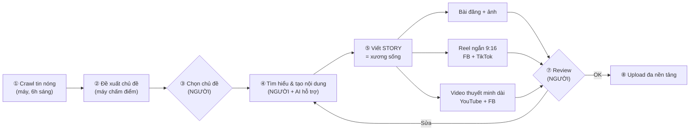

# Ý TƯỞNG: KÊNH "GIẢI MÃ QUY HOẠCH – BĐS – KINH TẾ" ĐA NỀN TẢNG

> Bản giới thiệu gửi 2 em · Ngày 30/09/2026
> Đọc trong 10 phút. Mục tiêu là cả 3 anh em hiểu cùng một bức tranh trước khi bắt tay làm.
> Tài liệu chi tiết hơn (kỹ thuật, chi phí, SOP): [blueprint_kenh_bds_ai_agent.md](blueprint_kenh_bds_ai_agent.md) · [sop_ban_giao_kenh_bds.md](sop_ban_giao_kenh_bds.md)

---

## 1. Nói ngắn gọn trong 1 câu

**Mỗi sáng, máy tự gom tin nóng và gợi ý chủ đề; anh em mình chọn 1 chủ đề, tìm hiểu kỹ, viết thành 1 câu chuyện; từ câu chuyện đó AI giúp "nhân bản" ra bài viết, hình ảnh, video ngắn và video dài; mình duyệt lại rồi đăng lên Facebook, TikTok, YouTube.**

---

## 2. Tại sao làm cái này?

- **Nhu cầu có thật:** Người Việt rất quan tâm *đất ở đâu sắp lên, đường nào sắp mở, nhà mình có dính quy hoạch không, kinh tế đang đi về đâu*. Nhưng thông tin thì rải rác, khó đọc (văn bản pháp lý, quyết định quy hoạch), và nhiều kênh chỉ là "cò đất" rao bán.
- **Khoảng trống:** Ít kênh giải thích **dễ hiểu – có nguồn – có bản đồ** và trung lập, không bán hàng.
- **Lợi thế của mình:** Có AI để làm nhanh 80% phần việc tay chân (gom tin, viết nháp, lồng tiếng, dựng video). Người chỉ tập trung vào 20% quan trọng nhất: **chọn đề tài, hiểu đúng, kể hay, kiểm tra sai sót**.
- **Giá trị lâu dài:** Kênh có tệp người xem "có tiền, có nhu cầu" → sau này mở được dịch vụ tra cứu quy hoạch, hợp tác quảng cáo, giới thiệu khách… (chưa cần nghĩ tới giai đoạn đầu).

---

## 3. Quy trình 8 bước (máy làm gì – người làm gì)

| Bước | Việc gì | Ai làm | Kết quả |
| :-- | :-- | :-- | :-- |
| **① Crawl tin** | Tự động quét báo uy tín (CafeF, VnExpress BĐS, Báo Xây Dựng, Cổng TT Chính phủ, Thư viện Pháp luật…) | Máy | Danh sách ~30–50 tin mới mỗi sáng |
| **② Đề xuất chủ đề** | AI lọc trùng, chấm điểm theo *độ hot · ảnh hưởng tới túi tiền người xem · dễ minh họa bằng bản đồ* | Máy | Top 3–5 chủ đề kèm link gốc, gửi vào nhóm chat |
| **③ Chọn chủ đề** | Chọn **1 chủ đề/ngày** | Người | 1 đề tài chốt trước 9h |
| **④ Tìm hiểu & tạo nội dung** | Đọc nguồn gốc (quyết định, bản đồ, số liệu), dùng AI hỏi đáp/tóm tắt, ghi lại các "fact" có nguồn | Người + AI | File ghi chú: sự kiện – số liệu – nguồn – bản đồ |
| **⑤ Viết story** | Kể lại thành **1 câu chuyện có mở – thân – kết**: chuyện gì xảy ra, ai được/mất, người xem nên làm gì | Người + AI | 1 bản story ~400–800 chữ (xương sống cho mọi định dạng) |
| **⑥ Sản xuất** | Từ story, AI chuyển thể thành 4 sản phẩm (xem mục 4) | AI làm, người chỉnh | Bộ nội dung hoàn chỉnh |
| **⑦ Review** | Kiểm tra số liệu, pháp lý, lỗi chính tả, hình ảnh, âm thanh | Người | Duyệt / trả về sửa |
| **⑧ Upload** | Đăng đúng khung giờ vàng, caption + hashtag cho từng nền tảng | Người (sau này tự động) | Nội dung lên sóng |

> **Ý quan trọng nhất:** Bước ④ và ⑤ là **"linh hồn" của kênh** – không giao hết cho AI. AI viết rất trơn nhưng hay bịa số liệu. Người phải hiểu vấn đề thì câu chuyện mới đúng và mới hay.

---

## 4. Một chủ đề → 4 sản phẩm ("nấu 1 nồi, chia 4 món")

| Sản phẩm | Nền tảng | Độ dài | Vai trò |
| :-- | :-- | :-- | :-- |
| **Bài đăng phân tích** | Facebook Page | 500–800 chữ | Xây uy tín, được share vào hội nhóm BĐS |
| **Bộ ảnh đính kèm** | Facebook (kèm bài) | 3–5 ảnh | Bản đồ vệ tinh có vẽ vạch quy hoạch, trích văn bản, biểu đồ giá |
| **Reel ngắn** | TikTok + Facebook Reels (+ YouTube Shorts) | 45–90 giây, dọc 9:16 | Kéo lượt xem, tìm người theo dõi mới |
| **Video thuyết minh dài** | YouTube + Facebook | 5–12 phút, ngang 16:9 | Giữ chân người xem sâu, tăng thời gian xem, sau này kiếm tiền từ YouTube |

**Ví dụ với chủ đề "Vành đai 3 đoạn qua Bình Chánh chuẩn bị thông xe":**
- *Bài đăng:* "3 xã hưởng lợi rõ nhất khi Vành đai 3 thông xe – và 1 cái bẫy mua đất cần tránh".
- *Ảnh:* Bản đồ vệ tinh vẽ tuyến đường đỏ, 3 nút giao khoanh vàng, trích quyết định phê duyệt.
- *Reel:* 3 giây đầu: "Đừng vội mua đất gần Vành đai 3 nếu chưa xem video này" → bản đồ zoom → 3 ý chính → kêu gọi comment.
- *Video dài:* Lịch sử dự án → tiến độ → phân tích từng nút giao → giá đất trước/sau → lời khuyên.

---

## 5. Phân vai 3 anh em (đề xuất – cùng bàn lại)

| | **Anh** – Tổng biên tập | **Em A** – Nội dung & Nghiên cứu | **Em B** – Sản xuất & Kênh |
| :-- | :-- | :-- | :-- |
| **Chính** | Định hướng kênh, chốt chủ đề, duyệt cuối | Tìm hiểu chủ đề, viết story, viết bài đăng | Làm ảnh, reel, video dài, đăng bài, trả lời comment |
| **Công cụ** | Nhóm chat duyệt | ChatGPT/Claude/Gemini, Google Earth, báo & văn bản gốc | CapCut, Canva, giọng đọc AI (ElevenLabs/Vbee), công cụ tạo ảnh |
| **Chịu trách nhiệm** | Sai pháp lý, sai định hướng | Đúng số liệu, có nguồn, câu chuyện hay | Hình/tiếng đẹp, đăng đúng giờ, kênh phát triển |

Máy (pipeline AI) do anh dựng dần, lúc đầu làm tay – khi quen việc mới tự động hóa từng khâu.

---

## 6. Một ngày làm việc mẫu

| Giờ | Việc |
| :-- | :-- |
| 06:00 | Máy crawl tin + gửi 3–5 chủ đề đề xuất vào nhóm chat |
| 08:30–09:00 | Cả 3 xem, **chốt 1 chủ đề** |
| 09:00–12:00 | Em A tìm hiểu + viết story + bài đăng |
| 12:00 | Anh duyệt nhanh story (đúng chưa, hay chưa) |
| 13:00–17:00 | Em B làm ảnh + reel + video dài từ story |
| 17:00 | Anh review bộ thành phẩm (checklist mục 7) |
| 17:30 / 19:45 | Đăng bài Facebook / Đăng reel TikTok + FB · Video dài đăng YouTube theo lịch |

> Giai đoạn đầu có thể **1 chủ đề / 2 ngày** hoặc **video dài 1–2 lần/tuần** – quan trọng là **đều đặn**, không phải nhiều.

---

## 7. Checklist review trước khi đăng (2–5 phút)

- [ ] Số quyết định, tên dự án, số liệu, mốc thời gian **khớp nguồn gốc**?
- [ ] Không khẳng định kiểu "chắc chắn tăng giá", không kêu gọi mua bán?
- [ ] 3 giây đầu reel có đủ "móc" để người xem dừng lại?
- [ ] Giọng đọc rõ, nhạc nền nhỏ hơn giọng, phụ đề đầy đủ, không bị che bởi nút TikTok?
- [ ] Ảnh/bản đồ rõ nét, có chú thích, ghi nguồn?
- [ ] Caption + hashtag đúng từng nền tảng?

---

## 8. Nguyên tắc vàng của kênh

1. **Có nguồn mới nói.** Mỗi con số phải chỉ ra được lấy từ đâu. Sai 1 lần là mất uy tín.
2. **Giải thích, không rao bán.** Không làm cò, không nhận "chạy" dự án giai đoạn đầu.
3. **Bản đồ thật > ảnh AI đẹp.** Người xem cần thấy *chỗ nào*, không cần tòa nhà tưởng tượng.
4. **Đều đặn quan trọng hơn hoàn hảo.** Thuật toán thưởng cho kênh đăng đều.
5. **Đo và sửa.** Mỗi tuần xem lại video nào giữ chân tốt, chủ đề nào nhiều comment → làm thêm kiểu đó.

---

## 9. Lộ trình 30 ngày đầu

| Tuần | Mục tiêu | Cách làm |
| :-- | :-- | :-- |
| **1** | Dựng kênh + làm 3 bộ nội dung mẫu | Lập Page FB, TikTok, YouTube cùng tên/logo. Làm tay hoàn toàn để hiểu quy trình. |
| **2** | Chốt "mẫu chuẩn" | Thống nhất font, màu, giọng đọc, bố cục reel, cấu trúc bài viết. Đăng đều 1 bộ/ngày hoặc 2 ngày. |
| **3** | Tự động bước ①–② | Anh dựng script crawl tin + AI gợi ý chủ đề gửi vào nhóm chat mỗi sáng. |
| **4** | Tự động 1 phần bước ⑥ + đo lường | Mẫu prompt chuyển story → kịch bản reel/video dài, giọng đọc AI tự động. Xem số liệu, điều chỉnh. |

**Mục tiêu 3 tháng đầu (tham khảo):** ~60 bộ nội dung · 1.000–5.000 người theo dõi mỗi nền tảng · tìm ra 2–3 dạng chủ đề "ăn khách" nhất.

---

## 10. Anh cần 2 em trả lời

1. Mỗi em dành được **bao nhiêu giờ/ngày** (hoặc/tuần)?
2. Em nào thích phần **đọc – viết – nghiên cứu**, em nào thích phần **hình – video – mạng xã hội**?
3. Các em đã dùng quen công cụ nào (CapCut, Canva, ChatGPT…)?
4. Đặt tên kênh gì? (mỗi người đề xuất 3 tên)
5. Ngày nào mình họp khởi động và làm **bộ nội dung mẫu #1** cùng nhau?

---

*Tóm lại:* **Máy lo phần nhiều – người lo phần đúng và phần hay.** Mình không cần giỏi hết từ đầu; làm tay trước, hiểu việc rồi tự động hóa dần.
