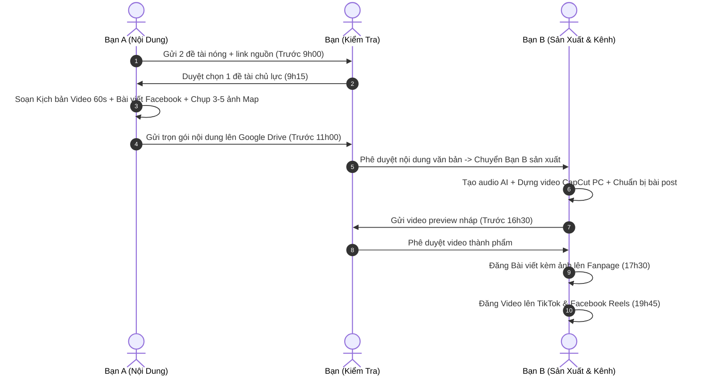

# HƯỚNG DẪN BẮT ĐẦU & TÀI LIỆU BÀN GIAO SẢN XUẤT KÊNH NỘI DUNG ĐA NỀN TẢNG
## Dự án: Hệ Thống Kênh Dữ Liệu BĐS, Bản Đồ & Quy Hoạch (Facebook Post + Reels + TikTok)

> **Mô hình nhân sự:**  
> - **Chủ dự án (Bạn):** Thẩm định pháp lý/số liệu, duyệt đề tài, bài viết và video trước khi đăng, định hướng chiến lược.  
> - **Nhân sự A (Content & Data Lead):** Săn tin, vận hành AI viết kịch bản video 60s + soạn bài viết Facebook 600 từ, chụp bộ ảnh bản đồ 3-5 tấm.  
> - **Nhân sự B (Production & Channel Lead):** Dựng video ngắn (TikTok + Reels), xuất giọng đọc AI, thiết kế ảnh bìa, đăng bài viết & video lên các nền tảng, quản lý tương tác.

---

## PHẦN 1: CHIẾN LƯỢC "1 ĐỀ TÀI - ĐA ĐỊNH DẠNG"

Không làm 2 nội dung tách rời để tránh tốn gấp đôi công sức:
1. **Mỗi ngày chọn duy nhất 1 đề tài nóng** (Ví dụ: Tuyến Vành đai 3 qua huyện Bình Chánh).
2. **AI hỗ trợ xé nhỏ thành 2 sản phẩm:**
   - **Sản phẩm 1 (Video ngắn 60s):** Xuất bản trên **TikTok** & **Facebook Reels** (Visual bản đồ 3D zoom + giọng đọc AI dồn dập + phụ đề nhảy chữ) -> Mục tiêu: *Kéo traffic triệu view*.
   - **Sản phẩm 2 (Bài viết phân tích chuyên sâu 500-800 từ):** Xuất bản trên **Facebook Fanpage** kèm album 3-5 ảnh nét (ảnh vệ tinh vẽ vạch quy hoạch, trích đoạn công văn, biểu đồ giá) -> Mục tiêu: *Xây uy tín chuyên gia, kích thích thảo luận và share vào hội nhóm BĐS*.

---

## PHẦN 2: BẢNG PHÂN CÔNG VAI TRÒ & NHIỆM VỤ

| Hạng mục | Nhân sự A (Nội dung & Dữ liệu) | Nhân sự B (Video & Vận hành Kênh) | Chủ dự án (Bạn - Kiểm tra) |
| :--- | :--- | :--- | :--- |
| **1. Đề tài hàng ngày** | Tìm 2 đề tài nóng/ngày kèm link báo gốc, văn bản hoặc tọa độ bản đồ. | Đóng góp ý kiến về góc nhìn trực quan. | **Chốt chọn 1 đề tài lúc 9h00.** |
| **2. Kịch bản Video** | Prompt AI viết kịch bản linh hoạt theo đề tài (không ép 60s; đảm bảo đủ ý & giữ nhịp cuốn hút) theo khung Hook-Data-Insight-CTA. | Đọc nhẩm đo thời lượng, chia nhịp dựng và phân cảnh visual. | **Soát lỗi logic, độ đủ ý và số liệu.** |
| **3. Bài viết Facebook Post** | Dùng AI mở rộng đề tài thành bài phân tích 500-800 từ (tiêu đề giật tít, chia đoạn ngắn, có icon). | N/A | **Duyệt văn phong và rủi ro pháp lý.** |
| **4. Tư liệu hình ảnh** | Mở Google Earth Pro / Remaps chụp 3-5 tấm ảnh bản đồ độ nét cao (vẽ sẵn mũi tên, vạch đỏ). | Thiết kế ảnh bìa (thumbnail) bài viết nếu cần. | Kiểm tra tính xác thực của tư liệu. |
| **5. Sản xuất Video** | N/A | Tạo audio giọng đọc AI, dựng CapCut PC (zoom map, vẽ vạch đỏ, auto-caption). | **Nghiệm thu video thành phẩm.** |
| **6. Đăng bài đa kênh** | Soạn sẵn bộ hashtag và caption ngắn cho Reels/TikTok. | • Đăng Bài viết Facebook lúc 17h30. • Đăng Video ngắn TikTok/Reels lúc 19h45. | Theo dõi chỉ số tương tác và chuyển đổi. |

---

## PHẦN 3: LỊCH TRÌNH VẬN HÀNH HÀNG NGÀY (DAILY TIMELINE)

---

## PHẦN 4: CHECKLIST NGHIỆM THU DÀNH CHO BẠN (DUYỆT NHANH 2 PHÚT)

### 1. Duyệt Kịch bản Video & Bài viết Facebook:
- [ ] **Kịch bản Video:** Có câu Hook gây sốc 3 giây đầu không? Nội dung có truyền tải đầy đủ bản chất vấn đề mà không bị lan man không?
- [ ] **Bài viết Facebook:** Tiêu đề có bắt mắt không? Có chia đầu dòng rõ ràng, dễ đọc trên điện thoại không?
- [ ] **Số liệu:** Tên dự án, số quyết định, mốc bàn giao có khớp với bài báo gốc không?
- [ ] **Hình ảnh đi kèm:** Bộ 3-5 ảnh bản đồ có rõ nét và có vạch chỉ dẫn màu đỏ/vàng trực quan không?

### 2. Duyệt Video thành phẩm:
- [ ] **Bản đồ 3D:** Có chuyển động zoom mạnh mẽ từ trên cao xuống vị trí khu đất không?
- [ ] **Âm thanh:** Giọng đọc AI có to rõ, dứt khoát? Nhạc nền không được to hơn tiếng đọc.
- [ ] **Phụ đề:** Toàn bộ video có phụ đề tự động nhảy chữ, từ khóa quan trọng có đổi màu không?
- [ ] **Vùng an toàn:** Chữ không bị che bởi logo hoặc nút like/comment của TikTok/Reels.

---

## PHẦN 5: KẾ HOẠCH KHỞI ĐỘNG TUẦN ĐẦU TIÊN (SPRINT 1)

* **Ngày 1:** Họp bàn giao bảng phân công này, lập Fanpage Facebook + Kênh TikTok đồng bộ nhận diện thương hiệu.
* **Ngày 2:** Cài đặt xong toàn bộ công cụ: Google Earth Pro, CapCut PC, tài khoản AI và giọng đọc TTS.
* **Ngày 3:** Cùng nhau làm **Gói Nội Dung Mẫu #1** (1 bài viết phân tích + 1 video ngắn về tuyến Vành đai 3) để chốt form mẫu chuẩn cho cả bài viết và video.
* **Ngày 4:** Làm **Gói Nội Dung Mẫu #2** (chủ đề pháp lý hoặc sáp nhập tỉnh) để hoàn thiện tốc độ phối hợp.
* **Ngày 5 trở đi:** Bắt đầu chạy guồng chính thức mỗi ngày 1 gói nội dung đa nền tảng.
